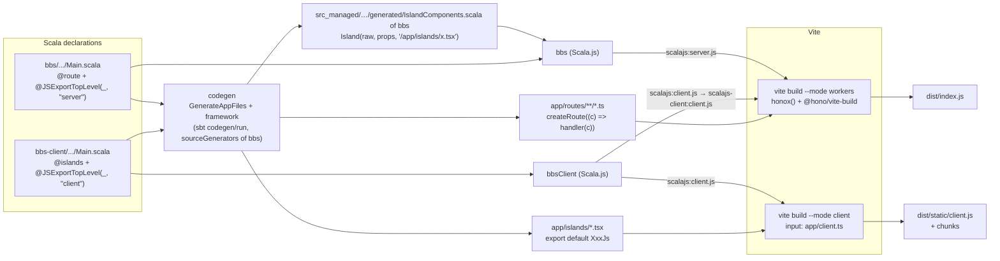
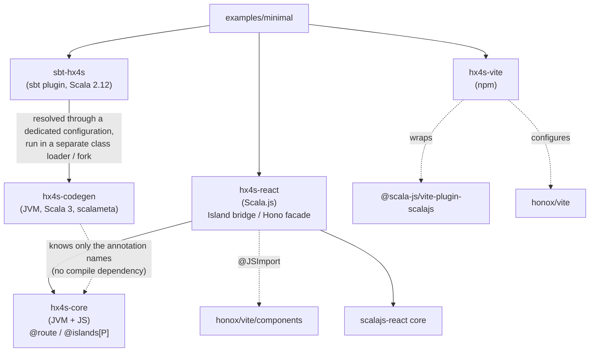

# Architecture

## 1. Scope of the investigation

**Reference point**: commit `875a47b` of the 3ch repository (3CH below) (`refactor(codegen): split the generic parts into the framework package and return errors as values`), and the working tree as of 2026-11-16.
**3CH's Phases 1 / 2 are in progress, and the working tree may change** (during the investigation, `HonoFacade.scala` was being split, and `common/src/main/scala-js/.../islands/` and `validation/` were being added).
When starting work, re-read the current state of 3CH and check that it hasn't drifted from the "current implementation" described here. Places whose structure changed during the investigation (such as the move from the old `AnnotatedAppEntries` to the `framework` package) have been rewritten with the current file names.

The following files of 3CH were read. Nothing was written to 3CH during this investigation, and sbt / npm were not run.
Therefore build and test results are not confirmed in this document; the descriptions are based on reading the sources and existing documents.

- Build: `build.sbt`, `project/plugins.sbt`, `project/build.properties`, `package.json`, `package-lock.json`, `vite.config.ts`, `tsconfig.json`
- Wiring: `app/server.ts`, `app/client.ts`, `app/routes/**`, `app/islands/*.tsx`, `app/renderer.d.ts`, `app/scalajs-server.d.ts`
- Declarations and generation: `common/src/main/scala/io/_3ch/common/routes/{Annotations,RouteTable}.scala`, `codegen/src/{main,test}/scala/io/_3ch/codegen/{*,framework/*}`
- Scala.js: `bbs/.../Main.scala`, `bbs/.../external/{honox/Island.scala, hono/{HonoContext,HonoContextFacade}.scala, web/WebFacade.scala}`, `bbs/.../handler/RendererShell.scala`,
  `bbs/.../components/*` (callers of IslandComponents), `bbs-client/.../Main.scala`, `bbs-client/.../islands/*` (representative examples), `bbs/src/test/.../IslandTestExports.scala`
- Test support: `bbs/test-stubs/*`, `tests/{islands-bridge,islands-hydration,board-islands,board-top-hydration,client-bundle,worker-bundle}.test.js`
- Documents: `AGENTS.md`, `docs/{islands-ssr,islands-ssr-review,route-annotations-review,island-props型付け計画,client-build-review,handler-rendering,development}.md`
- HonoX 0.1.62 distribution: `node_modules/honox/dist/{vite/index.js, vite/client.js, vite/island-components.js, vite/inject-importing-islands.js, vite/utils/path.js, vite/components/honox-island.js, client/client.js, client/runtime.js, server/server.js, server/with-defaults.js, server/utils/file.js, factory/factory.js, constants.js}`
- `node_modules/@scala-js/vite-plugin-scalajs/dist/index.js`

## 2. Current implementation

### 2.1 sbt projects

| Project | Kind | Role |
| --- | --- | --- |
| `common` | crossProject (Pure, JVM + JS) | Pure logic. Annotations and `RouteTable` (`publicPatterns`) live together in `routes/`. The generation templates had moved to `codegen` as of `875a47b` |
| `bbs` | Scala.js (ESModule) | The Worker itself, DOs, handlers, SSR components. `Main` with `@route` |
| `bbsClient` | Scala.js (ESModule) | Islands for the browser. `Main` with `@islands`. Linked independently of `bbs` (KB-27) |
| `codegen` | JVM | Generic parts in the `framework` package (configured with `CodegenConfig`). Reads `Main` with scalameta and generates `app/routes`, `app/islands` and `IslandComponents.scala`. Also generates DO TS types and RPC stubs (3ch-specific) |

`bbs` doesn't depend on `bbsClient`. The island code SSR needs is loaded from `bbsClient`'s link output
as Vite's virtual module `scalajs:client.js`.

### 2.2 Data flow

1. Declarations in `bbs.Main` carry `@route("auth/index.ts")` together with `@JSExportTopLevel("authPageHandler", "server")`.
   `bbsclient.Main` carries `@islands("posting-form.tsx")` together with `@JSExportTopLevel("PostingFormJs", "client")`.
2. `npm run v6:generate` (= `sbt codegen/run`) runs `GenerateAppFiles.main`, which calls `framework`'s `Codegen.appFiles` with a `CodegenConfig`.
   The input paths, `bbs/src/main/scala/io/_3ch/bbs/Main.scala` and `bbs-client/src/main/scala/io/_3ch/bbsclient/Main.scala`, are held by `GenerateAppFiles.config`.
   The same run also writes the DO TS types `app/scalajs-durable-objects.generated.d.ts` (3ch-specific).
3. There are three kinds of output: `app/routes/**/*.ts` (HonoX file routes), `app/islands/*.tsx` (entry points for HonoX's client discovery),
   and `IslandComponents.scala` (Scala API for SSR). The outputs in `app/routes` and `app/islands` are under Git.
   `IslandComponents.scala` is written to `src_managed` by `bbs`'s `Compile / sourceGenerators` calling `GenerateAppFiles --island-components` (`generateIslandComponents` in `build.sbt`),
   so it is not in the source tree and is generated by compiling `bbs` even right after a clone. The former `bbs/src/main/scala/.../generated/IslandComponents.scala` is deleted by `GenerateAppFiles` if found.
4. `vite build --mode client` runs `fullLinkJS` for `bbsClient` (`@scala-js/vite-plugin-scalajs` runs `sbt print bbsClient/fullLinkJSOutput`)
   and outputs `dist/static/client.js` with `app/client.ts` as the entry. HonoX's `createClient` lazily imports islands with `import.meta.glob('/app/islands/**/*.tsx')`.
5. `vite build --mode workers` links `bbs` and `bbsClient` in turn, assembles the Worker from `app/server.ts` with the `honox()` plugin,
   and `@hono/vite-build/cloudflare-workers` outputs `dist/index.js`. Re-exports of DO classes are added with `entryContentAfterHooks`.
6. At run time, HonoX's `createApp` turns the files in `app/routes` into Hono routes, and the generated routes call the Scala handlers.
   Handlers pass scalajs-react elements to `c.render`, and through `_renderer.tsx` (`@hono/react-renderer`), `renderShell` (Scala) builds the whole HTML.
   For islands, `IslandComponents.Xxx(props)` creates `React.createElement(HonoXIsland, {Component, props, componentName})`,
   which is output as `<honox-island component-name="/app/islands/x.tsx" data-serialized-props="…">`.
7. In the browser, `createClient` matches `component-name` against the glob keys and runs `hydrateRoot` on the default export of the generated TSX (= the Scala.js island)
   with the JSON in `data-serialized-props`.

### 2.3 Files and responsibilities

| File | Responsibility | Hand-written / generated |
| --- | --- | --- |
| `common/.../routes/Annotations.scala` | `final class route(filePath, method = "GET")`, `final class islands(filePath)`. Both are `StaticAnnotation`s | Hand-written |
| `common/.../routes/RouteTable.scala` | Public compatibility patterns `publicPatterns` (3ch-specific). Generation templates have moved to `codegen/.../framework/` | Hand-written |
| `codegen/.../framework/AnnotationScanner.scala` | Walks `Defn.Def` / `Defn.Val` of `object Main` with scalameta, validates annotation arguments (string literals only), export names, moduleIDs and output paths, and produces `AppEntries` (`framework/AppEntries.scala`) | Hand-written |
| `codegen/.../framework/AppFileRenderer.scala` | Builds the strings of route TS, island TSX and `IslandComponents.scala` | Hand-written |
| `codegen/.../framework/{OutputPath,OutputWriter}.scala` | Checking output paths, all checks before writing, skipping identical content, protecting hand-written files, deleting stale generated files | Hand-written |
| `codegen/.../framework/{Codegen,CodegenConfig,CodegenError,CodegenReport}.scala` | Settings case class, the generation entry point, a type that returns errors as values, reporting | Hand-written |
| `codegen/.../GenerateAppFiles.scala` | 3ch's `CodegenConfig` (input paths, moduleIDs, output directories, package, banner) and CLI main (`--project-root`, `--island-components`). Writing DO TS types is here too | Hand-written |
| `codegen/.../{DurableObjectSources,GenerateDurableObjectTypes,GenerateDurableObjectStubs,GenerateDurableObjectStubsMain}.scala` | Generating DO TS types and RPC stubs (3ch-specific) | Hand-written |
| `bbs/.../external/honox/Island.scala` | The facade for `@JSImport("honox/vite/components", "HonoXIsland")` and `Island.apply` | Hand-written |
| `bbs/.../external/hono/{HonoContext,HonoContextFacade}.scala` | `HonoRequestFacade` / `HonoContextFacade` (with `env: WorkerEnv` fixed), `RenderProps` (`title`, `authModal`), the `renderPromise` extension. In the investigated working tree, these were being split out of the old `HonoFacade.scala` | Hand-written |
| `bbs/.../external/web/WebFacade.scala` | Hand-written facades for the Fetch API `Request` / `Response` / `Headers` | Hand-written |
| `bbs/.../handler/RendererShell.scala` | The HTML shell (`<html lang="ja">`, CSS, client script, auth modal) and Shift_JIS responses | Hand-written (3ch-specific) |
| `app/server.ts` | `createApp`, middleware (Client Hints, trailing slash), auth API, fallback to `publicHandler`, re-exporting DOs | Hand-written |
| `app/client.ts` | Passes React's `hydrateRoot` / `createElement` to `createClient` | Hand-written |
| `app/routes/_renderer.tsx` | Calls Scala's `renderShell` from `reactRenderer` | Hand-written |
| `app/routes/{index.ts, admin/index.ts, auth.js.ts, bbsmenu.html.ts}` | Hand-written routes that pass to the existing fetch (`publicHandler`) | Hand-written |
| `app/routes/{[bbs]/index.ts, auth/**/index.ts}` | Generated from `@route` | Generated |
| `app/islands/*.tsx` (12 files) | Generated from `@islands` | Generated |
| `bbs/test-stubs/*.mjs` | Replace `cloudflare:workers`, `scalajs:client.js` and `hono/jsx` inside HonoX using Node module hooks | Hand-written |
| `vite.config.ts` | The `scalaProject` wrapper (serializing `buildStart`), settings for two modes, aliases, Tailwind, Cloudflare build | Hand-written |

### 2.4 Implementation notes

- **Exports live next to declarations**: an annotation is read together with the `@JSExportTopLevel(name, moduleID)` on the same declaration. The export name determines the import name in the generated TS and
  the method name in `IslandComponents`. `AnnotationScanner` checks that the moduleID matches `CodegenConfig.serverModule` / `clientModule` (3ch uses `server` / `client`).
- **SSR doesn't import the generated TSX**: `IslandComponents` `@JSImport`s the raw export from `scalajs:client.js` directly and wraps it in `HonoXIsland`
  (`docs/islands-ssr.md`). It is the wrapping that HonoX's Vite transform (`island-components.js`) applies to TSX, assembled by hand on the Scala side.
- **Swapping in React**: the source of `HonoXIsland` imports `hono/jsx`. `honox({ islandComponents: { reactApiImportSource: "react" } })` replaces it with `react` by string substitution
  when loading files under `/honox/.*/(server|vite)/components/`. In tests on Node, `test-stubs/cloudflare-workers-loader.mjs` reproduces
  the same substitution with module hooks.
- **The client build doesn't use the HonoX plugin**: the settings for `mode === "client"` have no `honox()`; Rollup's `input` and output names are specified directly.
  HonoX's `honox-vite-client` (which adds `manifest: true` and so on) doesn't take effect.
- **Island detection is always treated as on**: `RendererShell.render` always outputs `<script type="module" src=…>`. HonoX's `HasIslands` / `__importing_islands` are not used.
  The generated routes import `scalajs:server.js` rather than TSX, so HonoX's dependency-tree walk (`inject-importing-islands.js`) can't detect island usage (a guess; behavior not confirmed).
- **Missing types**: island props are built with `js.Object` / `js.Dynamic.literal`, and the client reads them back with `selectDynamic`.
  Handlers take `c: js.Any` and do `asInstanceOf[HonoContextFacade]`. The generated routes put `@ts-expect-error` on the imports of virtual modules.

### 2.5 Discrepancies between documents and implementation

| Document | Statement | Implementation |
| --- | --- | --- |
| `docs/handler-rendering.md` | Register `RouteEntry(...PassThrough...)` in `RouteTable.routes`. SSR imports the generated TSX with `@JSImport("/app/islands/thread-view.tsx", "default")`. Keep registering in `RouteTable.islands` | Migrated to the annotation approach. `RouteTable.routes` / `RouteTable.islands` don't exist. SSR uses the `HonoXIsland` facade and doesn't import TSX |
| `docs/islands-ssr.md` | Depends on the behavior of HonoX 0.1.61 | `package.json` is `^0.1.62`, and so is the lock |
| `docs/islands-ssr.md` | An example exporting `val threadView = ThreadView.component` | The implementation is `XxxIsland.Component.toJsComponent.raw` (type `js.Any`) |
| `docs/client-build-review.md` | Verifies that `pong-from-client` remains in client.js | `tests/client-bundle.test.js` uses `3ch:draft:` as the positive marker |
| `docs/route-annotations-review.md` | Generates `_v6/health.ts` (one health route) | The current `bbs.Main` has no `@route` for health. There are 5 generated routes |
| Step 1 of chapter 3 of `docs/island-props型付け計画.md` | Add `common/src/main/scala-js` to `jsSettings` | Already added in `build.sbt` (used by `domain/account` and `domain/device`). `io._3ch.common.islands` (`AccountIslandProps`, `BoardIslandProps`) and `validation/JsShape.scala` appeared uncommitted in the working tree during the investigation (Phase 1 step 1-1 is in progress) |
| `AGENTS.md` 1.3 | The existing-fetch `app/routes/index.ts` is hand-written | There are other hand-written routes too: `admin/index.ts`, `auth.js.ts`, `bbsmenu.html.ts` |
| `AGENTS.md` 1.3 | The admin screen is a scalajs-react SPA | `docs/admin-spa-auth-plan.md` is a "plan (not started)". The current `/admin` is `publicHandler` → `AdminHandler` |
| `codegen/.../framework/AppEntries.scala` (`HttpMethod`) | Allows `HEAD` as the method of `@route` | HonoX `createApp`'s `METHODS` are GET/POST/PUT/DELETE/OPTIONS/PATCH. `export const HEAD` is not registered and is silently ignored (`HEAD` still passes as of `875a47b`) |
| `codegen/.../framework/{OutputPath,AnnotationScanner}.scala` | Output path segments are `[A-Za-z0-9_.$\[\]-]+`. Route basenames starting with `_` are rejected | HonoX's `ROUTES` glob excludes `_*`, `-*`, `$*`, `*.test.*` and `*.spec.*`. Anything other than a leading `_` (a leading `-` / `$`, `.test.ts`, `.spec.ts`, directories starting with `-`) still passes as of `875a47b`, and is generated but never becomes a route |
| `scalajs-durable-objects.generated.d.ts` of `GenerateAppFiles` | — | `OutputWriter.writeIfChanged` skips identical content but doesn't check the generated marker (a separate path from `OutputWriter.write` on the route / island side) |

hx4s's design is built on these premises. Fixing 3ch's documents is part of the Phase 1 work ([extraction-plan.md](extraction-plan.md)).
Discrepancies that 3ch resolved during the investigation (the old `AnnotatedAppEntries` "rewriting every time even with identical content", placing `IslandComponents.scala` in the source tree) are rewritten in the table above and in 2.2 to reflect the current state.

## 3. The overall picture of hx4s

### 3.1 Goals and non-goals

The goal is to provide the declarations, generation and build integration for putting Scala.js code on HonoX's file routes and Islands, in a form that doesn't depend on 3ch.

Non-goals:

- Replacing HonoX. Routing, middleware, renderers, and client discovery and hydration are left to HonoX.
- Abstracting the runtime. Differences between Cloudflare Workers / Node / Deno and so on are the responsibility of Hono and each build plugin, and are kept out of Core ([ADR 0005](adr/0005-core-independent-of-cloudflare.md)).
- Our own state management, Effect System or DI container (3.4).

### 3.2 Module dependency graph

- `hx4s-codegen` doesn't make `hx4s-core` a compile dependency. Annotations are matched by name as syntax, so there is no need to reference the types.
  As of `875a47b`, 3ch's `codegen` doesn't depend on `commonJVM` (`build.sbt`; only scalameta), and the generation templates are in `framework`'s `AppFileRenderer`.
- `sbt-hx4s` is built with Scala 2.12 for sbt 1.x. It can't load the Scala 3 `hx4s-codegen` in the same class loader,
  so codegen is resolved through a dedicated configuration and run in isolation ([build-integration.md](build-integration.md) chapter 3).
- User apps are expected to have three Scala.js projects: server, client and shared. shared holds the `P` of `@islands[P]` (non-native JS traits).

### 3.3 Division of responsibilities

| Responsibility | HonoX (and Hono / Vite) | hx4s |
| --- | --- | --- |
| Mapping URLs to files, dynamic parameters, trailing slashes, `_renderer` / `_middleware` / `_404` / `_error` | ○ | Only validates the file paths it generates |
| Request handling, middleware, `c.render` | ○ (Hono) | A typed facade for Context |
| Wrapping islands (the `honox-island` element, `data-serialized-props`, `<template data-hono-template>`, nesting detection) | ○ (`HonoXIsland`) | A bridge that calls `HonoXIsland` from Scala |
| Client island discovery, lazy imports, hydration | ○ (`createClient`) | Generating TSX that matches the discovery rules, an example configuration passing React's `hydrateRoot` |
| Linking Scala.js and resolving virtual modules | `@scala-js/vite-plugin-scalajs` | Bundles the server / client registration and aliases (hx4s-vite) |
| Annotation declarations | — | ○ (hx4s-core) |
| Generating wiring code (route TS, island TSX, `IslandComponents`) | — | ○ (hx4s-codegen) |
| Typed props | — | ○ (`@islands[P]` and the argument types of the generated API) |
| Runtime-specific processing (DO exports, Bindings, Static Assets) | Each `@hono/vite-build` adapter | Not included (the user's job; a future `hx4s-cloudflare` candidate) |

### 3.4 Design principles

- **Plain Promises and passing arguments**: the public API returns `js.Promise`, and whether to use `Future` on the Scala side is up to the user. Don't require an Effect System (cats-effect, ZIO, etc.) or
  a DI container. Dependencies are passed as handler arguments (Hono Context, Env). The reason is that 3ch is written without them,
  and forcing a choice on users increases bundle size and the learning burden. Thin integrations for Effect Systems will be considered in a separate module when there is demand.
- **Generated code is readable**: generated TS / Scala is kept short so that people can read and follow it, and is output deterministically ([ADR 0004](adr/0004-scalameta-codegen.md)).
- **Follow HonoX's conventions**: don't keep our own route table; use HonoX's file conventions as-is. hx4s owns only the part that "creates files following the conventions from Scala declarations".

## 4. Places that depend on HonoX internal APIs

HonoX is an alpha (0.1.x), and the following can hardly be called public APIs guaranteed by the README.
hx4s gathers them in one place and monitors them with compatibility tests ([compatibility.md](compatibility.md) chapter 3).

| # | Dependency | What depends on it | Current usage | How public |
| --- | --- | --- | --- | --- |
| H1 | `HonoXIsland` from `honox/vite/components` | The props shape `{ componentName, Component, props, componentExport? }` | `IslandProps` in `Island.scala` | It is in the package.json exports, but the BYOR documentation assumes use through the TSX transform. The shape is unspecified |
| H2 | Attribute names `component-name` / `data-serialized-props` / `data-hono-template` / `data-hono-hydrated` | Matching between SSR and the client | Expected values in tests, the format of the generated `componentName` | In `honox/constants`, but no specification document |
| H3 | The value of `component-name` = the absolute path from the Vite root (`/app/islands/x.tsx`) | `IslandComponents` assembles the string | `AppFileRenderer.islandComponents` | Not public. Breaks if `islandDir` is changed |
| H4 | String substitution of `hono/jsx` → `reactApiImportSource` by the `load` hook of `island-components.js` | Running `HonoXIsland` with React | `vite.config.ts`, the loader in `test-stubs` | The option name is public; the path regex it targets is internal |
| H5 | The glob and basename rule of `createClient` (`/app/islands/**/*.tsx`, `/[a-zA-Z0-9-]+\.tsx$/`) | File name constraints on generated TSX (a P0 public rule; [rendering-model.md](rendering-model.md) 1.4) | The `IslandBasename` check in `AnnotationScanner` | Behavior partly in the README; the regex is internal |
| H6 | The `hydrate` / `createElement` options of `createClient` | Passing React's `hydrateRoot` | `app/client.ts` | Public (BYOR) |
| H7 | `createApp`'s file conventions (default export = GET, named exports = methods, the set of `METHODS`, exclusion globs) | The shape of generated routes | `AppFileRenderer.route` | Conventions are in the README. The set of `METHODS` is internal |
| H8 | `createRoute` from `honox/factory` (= `createFactory().createHandlers`) | Generated routes | `AppFileRenderer.route` | Public |
| H9 | `honox()` sets `ssr.noExternal: true` and makes `./app/server.ts` the devServer entry | Workers build | `vite.config.ts` | Options are public |
| H10 | Handling of nested islands (inner islands are not wrapped via `IslandContext`; children go into templates) | Number of hydration boundaries | `tests/islands-hydration.test.js` | Not public |
| H11 | `filePathToPath` from `honox/server/utils/file`, and `createApp` mounting per-directory sub apps with `app.route` (hono's `mergePath`) | URL conflict checks of generated routes | `hx4s.codegen.RoutePath`, `tests/route-paths.test.js` (calls `createApp` from `honox/server/server` directly) | In the package.json exports, but the conversion rules are not in the README |
| H12 | The shape of elements when `createClient` restores element props from templates (`createElement(component, props)`, children as arrays) | Validating islands inside templates (`hx4s-vite/client`) | `vite/src/client.ts`, `tests/islands-hydration.test.js` | Not public |
