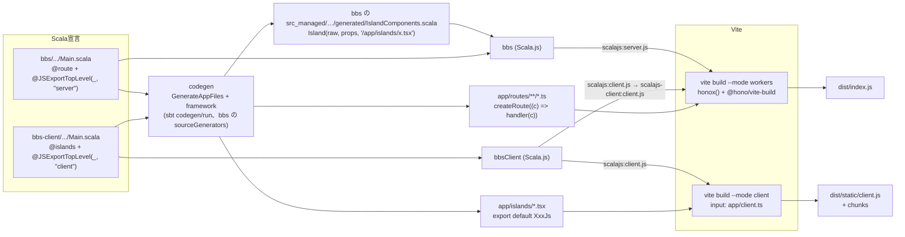
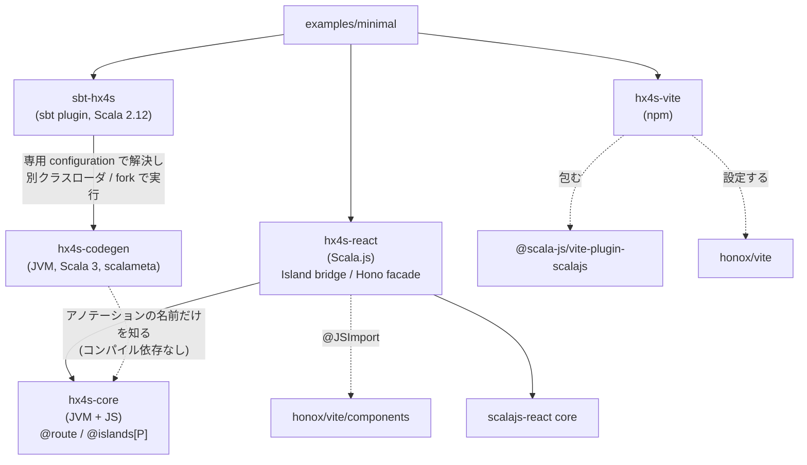

# アーキテクチャ

## 1. 調査範囲

**調査基準**: 3ch リポジトリ（以下 3CH）の commit `875a47b`（`refactor(codegen): 汎用部分を framework パッケージへ分け、誤りを値で返す`）と、2026-11-16 時点の作業ツリー。
**3CH の Phase 1 / 2 は進行中で、作業ツリーは変わりうる**（調査中にも `HonoFacade.scala` の分割、`common/src/main/scala-js/.../islands/` と `validation/` の追加が進んでいた）。
着手時に 3CH の現状を読み直し、この文書の「現行実装」の記述とずれていないか確かめること。調査の途中で構成が変わった箇所（旧 `AnnotatedAppEntries` から `framework` パッケージへの分離など）は、現在のファイル名で書き直してある。

3CH の次のファイルを読んだ。3CH にはこの調査で一切書き込んでおらず、sbt / npm も実行していない。
そのため、ビルドやテストの結果はこの文書では確認しておらず、記述はソースと既存文書の読解に基づく。

- ビルド: `build.sbt`, `project/plugins.sbt`, `project/build.properties`, `package.json`, `package-lock.json`, `vite.config.ts`, `tsconfig.json`
- 配線: `app/server.ts`, `app/client.ts`, `app/routes/**`, `app/islands/*.tsx`, `app/renderer.d.ts`, `app/scalajs-server.d.ts`
- 宣言と生成: `common/src/main/scala/io/_3ch/common/routes/{Annotations,RouteTable}.scala`, `codegen/src/{main,test}/scala/io/_3ch/codegen/{*,framework/*}`
- Scala.js: `bbs/.../Main.scala`, `bbs/.../external/{honox/Island.scala, hono/{HonoContext,HonoContextFacade}.scala, web/WebFacade.scala}`, `bbs/.../handler/RendererShell.scala`,
  `bbs/.../components/*`（IslandComponents の呼び出し側）, `bbs-client/.../Main.scala`, `bbs-client/.../islands/*`（代表例）, `bbs/src/test/.../IslandTestExports.scala`
- テスト支援: `bbs/test-stubs/*`, `tests/{islands-bridge,islands-hydration,board-islands,board-top-hydration,client-bundle,worker-bundle}.test.js`
- 文書: `AGENTS.md`, `docs/{islands-ssr,islands-ssr-review,route-annotations-review,island-props型付け計画,client-build-review,handler-rendering,development}.md`
- HonoX 0.1.62 の配布物: `node_modules/honox/dist/{vite/index.js, vite/client.js, vite/island-components.js, vite/inject-importing-islands.js, vite/utils/path.js, vite/components/honox-island.js, client/client.js, client/runtime.js, server/server.js, server/with-defaults.js, server/utils/file.js, factory/factory.js, constants.js}`
- `node_modules/@scala-js/vite-plugin-scalajs/dist/index.js`

## 2. 現行実装

### 2.1 sbt プロジェクト

| プロジェクト | 種別 | 役割 |
| --- | --- | --- |
| `common` | crossProject（Pure, JVM + JS） | 純粋ロジック。`routes/` にアノテーションと `RouteTable`（`publicPatterns`）が同居する。生成テンプレートは `875a47b` 時点で `codegen` 側へ移っている |
| `bbs` | Scala.js（ESModule） | Worker 本体・DO・ハンドラ・SSR コンポーネント。`@route` を持つ `Main` |
| `bbsClient` | Scala.js（ESModule） | ブラウザ向け island。`@islands` を持つ `Main`。`bbs` とは独立にリンクする（KB-27） |
| `codegen` | JVM | 汎用部分は `framework` パッケージ（`CodegenConfig` で設定）。scalameta で `Main` を読み、`app/routes`・`app/islands`・`IslandComponents.scala` を生成。DO の TS 型と RPC スタブも生成（3ch 固有） |

`bbs` は `bbsClient` に依存しない。SSR が必要とする island の実体は、`bbsClient` のリンク成果物を
Vite の仮想モジュール `scalajs:client.js` として読み込む。

### 2.2 データの流れ

1. `bbs.Main` の宣言に `@route("auth/index.ts")` と `@JSExportTopLevel("authPageHandler", "server")` を並べて書く。
   `bbsclient.Main` には `@islands("posting-form.tsx")` と `@JSExportTopLevel("PostingFormJs", "client")` を並べる。
2. `npm run v6:generate`（= `sbt codegen/run`）が `GenerateAppFiles.main` を実行し、`framework` の `Codegen.appFiles` を `CodegenConfig` つきで呼ぶ。
   入力パスは `bbs/src/main/scala/io/_3ch/bbs/Main.scala` と `bbs-client/src/main/scala/io/_3ch/bbsclient/Main.scala` で、`GenerateAppFiles.config` が持つ。
   同じ実行で DO の TS 型 `app/scalajs-durable-objects.generated.d.ts` も書く（3ch 固有）。
3. 生成物は 3 種。`app/routes/**/*.ts`（HonoX のファイルルート）、`app/islands/*.tsx`（HonoX のクライアント探索の入口）、
   `IslandComponents.scala`（SSR 用 Scala API）。`app/routes` と `app/islands` の生成物は Git 管理下。
   `IslandComponents.scala` は `bbs` の `Compile / sourceGenerators` が `GenerateAppFiles --island-components` を呼んで `src_managed` に出す（`build.sbt` の `generateIslandComponents`）ので、
   ソースツリーには置かれず、clone 直後でも `bbs` のコンパイルで生成される。以前の `bbs/src/main/scala/.../generated/IslandComponents.scala` は `GenerateAppFiles` が見つければ削除する。
4. `vite build --mode client` が `bbsClient` を `fullLinkJS` し（`@scala-js/vite-plugin-scalajs` が `sbt print bbsClient/fullLinkJSOutput` を実行）、
   `app/client.ts` を入口に `dist/static/client.js` を出す。HonoX の `createClient` が `import.meta.glob('/app/islands/**/*.tsx')` で island を遅延 import する。
5. `vite build --mode workers` が `bbs` と `bbsClient` を順にリンクし、`honox()` プラグインで `app/server.ts` を入口に Worker を組み立て、
   `@hono/vite-build/cloudflare-workers` が `dist/index.js` を出す。DO クラスの再 export は `entryContentAfterHooks` で足す。
6. 実行時、HonoX の `createApp` が `app/routes` のファイルを Hono のルートにし、生成ルートが Scala のハンドラを呼ぶ。
   ハンドラは scalajs-react の要素を `c.render` に渡し、`_renderer.tsx`（`@hono/react-renderer`）経由で `renderShell`（Scala）が HTML 全体を組み立てる。
   island は `IslandComponents.Xxx(props)` が `React.createElement(HonoXIsland, {Component, props, componentName})` を作り、
   `<honox-island component-name="/app/islands/x.tsx" data-serialized-props="…">` として出力される。
7. ブラウザでは `createClient` が `component-name` と glob のキーを突き合わせ、生成 TSX の default export（= Scala.js の island）を
   `data-serialized-props` の JSON で `hydrateRoot` する。

### 2.3 ファイルと責務

| ファイル | 責務 | 手書き / 生成 |
| --- | --- | --- |
| `common/.../routes/Annotations.scala` | `final class route(filePath, method = "GET")`、`final class islands(filePath)`。どちらも `StaticAnnotation` | 手書き |
| `common/.../routes/RouteTable.scala` | 公開互換パターン `publicPatterns`（3ch 固有）。生成テンプレートは `codegen/.../framework/` へ移動済み | 手書き |
| `codegen/.../framework/AnnotationScanner.scala` | scalameta で `object Main` の `Defn.Def` / `Defn.Val` を走査し、アノテーション引数（文字列リテラルのみ）・export 名・moduleID・出力パスを検証して `AppEntries`（`framework/AppEntries.scala`）にする | 手書き |
| `codegen/.../framework/AppFileRenderer.scala` | route TS・island TSX・`IslandComponents.scala` の文字列生成 | 手書き |
| `codegen/.../framework/{OutputPath,OutputWriter}.scala` | 出力パスの検査、書き込み前の全検査、同内容なら書かない、手書きファイルの保護、古い生成物の削除 | 手書き |
| `codegen/.../framework/{Codegen,CodegenConfig,CodegenError,CodegenReport}.scala` | 設定 case class、生成の入口、誤りを値で返す型、報告 | 手書き |
| `codegen/.../GenerateAppFiles.scala` | 3ch の `CodegenConfig`（入力パス・moduleID・出力先・パッケージ・バナー）と CLI main（`--project-root`、`--island-components`）。DO の TS 型の書き込みもここ | 手書き |
| `codegen/.../{DurableObjectSources,GenerateDurableObjectTypes,GenerateDurableObjectStubs,GenerateDurableObjectStubsMain}.scala` | DO の TS 型・RPC スタブ生成（3ch 固有） | 手書き |
| `bbs/.../external/honox/Island.scala` | `@JSImport("honox/vite/components", "HonoXIsland")` の facade と `Island.apply` | 手書き |
| `bbs/.../external/hono/{HonoContext,HonoContextFacade}.scala` | `HonoRequestFacade` / `HonoContextFacade`（`env: WorkerEnv` 固定）、`RenderProps`（`title`・`authModal`）、`renderPromise` 拡張。調査中の作業ツリーで旧 `HonoFacade.scala` から分割されている最中 | 手書き |
| `bbs/.../external/web/WebFacade.scala` | Fetch API `Request` / `Response` / `Headers` の手書き facade | 手書き |
| `bbs/.../handler/RendererShell.scala` | HTML シェル（`<html lang="ja">`、CSS、client script、認証モーダル）と Shift_JIS 応答 | 手書き（3ch 固有） |
| `app/server.ts` | `createApp`、ミドルウェア（Client Hints・末尾スラッシュ）、認証 API、`publicHandler` へのフォールバック、DO の再 export | 手書き |
| `app/client.ts` | `createClient` に React の `hydrateRoot` / `createElement` を渡す | 手書き |
| `app/routes/_renderer.tsx` | `reactRenderer` から Scala の `renderShell` を呼ぶ | 手書き |
| `app/routes/{index.ts, admin/index.ts, auth.js.ts, bbsmenu.html.ts}` | 既存 fetch（`publicHandler`）へ渡す手書きルート | 手書き |
| `app/routes/{[bbs]/index.ts, auth/**/index.ts}` | `@route` の生成物 | 生成 |
| `app/islands/*.tsx`（12 件） | `@islands` の生成物 | 生成 |
| `bbs/test-stubs/*.mjs` | Node の module hooks で `cloudflare:workers`・`scalajs:client.js`・HonoX 内の `hono/jsx` を差し替える | 手書き |
| `vite.config.ts` | `scalaProject` ラッパー（`buildStart` の直列化）、2 モードの設定、alias、Tailwind、Cloudflare ビルド | 手書き |

### 2.4 実装上の要点

- **export と宣言の同居**: アノテーションは同じ宣言の `@JSExportTopLevel(name, moduleID)` とセットで読む。export 名が生成 TS の import 名と
  `IslandComponents` のメソッド名を決める。moduleID は `CodegenConfig.serverModule` / `clientModule`（3ch の値は `server` / `client`）と一致することを `AnnotationScanner` が検査する。
- **SSR は生成 TSX を import しない**: `IslandComponents` は `scalajs:client.js` の raw export を直接 `@JSImport` し、`HonoXIsland` で包む
  （`docs/islands-ssr.md`）。HonoX の Vite 変換（`island-components.js`）が TSX に施すラップを Scala 側で手組みしている形である。
- **React への差し替え**: `HonoXIsland` のソースは `hono/jsx` を import する。`honox({ islandComponents: { reactApiImportSource: "react" } })` が
  `/honox/.*/(server|vite)/components/` 配下の読み込み時に文字列置換で `react` に変える。Node 上のテストでは `test-stubs/cloudflare-workers-loader.mjs` が
  同じ置換を module hooks で再現している。
- **client ビルドは HonoX プラグインを使わない**: `mode === "client"` の設定に `honox()` は無く、Rollup の `input` と出力名を直接指定している。
  HonoX の `honox-vite-client`（`manifest: true` などを足す）は効いていない。
- **島の検出は常に有効扱い**: `RendererShell.render` は常に `<script type="module" src=…>` を出す。HonoX の `HasIslands` / `__importing_islands` は使っていない。
  生成ルートは TSX ではなく `scalajs:server.js` を import するため、HonoX の依存木走査（`inject-importing-islands.js`）では island 使用を検出できない（推測。動作未確認）。
- **型付けの欠落**: island の props は `js.Object` / `js.Dynamic.literal` で組み立て、クライアントは `selectDynamic` で読み戻す。
  ハンドラは `c: js.Any` を受けて `asInstanceOf[HonoContextFacade]` している。生成ルートは仮想モジュールの import に `@ts-expect-error` を付けている。

### 2.5 文書と実装の食い違い

| 文書 | 記述 | 実装 |
| --- | --- | --- |
| `docs/handler-rendering.md` | `RouteTable.routes` に `RouteEntry(...PassThrough...)` を登録する。SSR は `@JSImport("/app/islands/thread-view.tsx", "default")` で生成 TSX を import する。`RouteTable.islands` の登録を維持する | アノテーション方式に移行済み。`RouteTable.routes` / `RouteTable.islands` は存在しない。SSR は `HonoXIsland` facade を使い TSX を import しない |
| `docs/islands-ssr.md` | HonoX 0.1.61 の挙動に依存 | `package.json` は `^0.1.62`、lock も 0.1.62 |
| `docs/islands-ssr.md` | `val threadView = ThreadView.component` を export する例 | 実装は `XxxIsland.Component.toJsComponent.raw`（型は `js.Any`） |
| `docs/client-build-review.md` | `pong-from-client` が client.js に残ることを検証 | `tests/client-bundle.test.js` は `3ch:draft:` を肯定マーカーにしている |
| `docs/route-annotations-review.md` | `_v6/health.ts` を生成（health 1 件） | 現行の `bbs.Main` に health の `@route` は無い。生成ルートは 5 件 |
| `docs/island-props型付け計画.md` 3 章手順 1 | `common/src/main/scala-js` を `jsSettings` に追加する | `build.sbt` には既に追加済み（`domain/account`・`domain/device` が使用）。`io._3ch.common.islands`（`AccountIslandProps`・`BoardIslandProps`）と `validation/JsShape.scala` は調査中の作業ツリーに未コミットで現れた（Phase 1 の 1-1 が進行中） |
| `AGENTS.md` 1.3 | 既存 fetch の `app/routes/index.ts` は手書き | 手書きルートは他に `admin/index.ts`・`auth.js.ts`・`bbsmenu.html.ts` がある |
| `AGENTS.md` 1.3 | 管理画面は scalajs-react の SPA | `docs/admin-spa-auth-plan.md` は「計画（未着手）」。現行の `/admin` は `publicHandler` → `AdminHandler` |
| `codegen/.../framework/AppEntries.scala`（`HttpMethod`） | `@route` の method に `HEAD` を許す | HonoX `createApp` の `METHODS` は GET/POST/PUT/DELETE/OPTIONS/PATCH。`export const HEAD` は登録されず黙って無視される（`875a47b` 時点でも `HEAD` は通る） |
| `codegen/.../framework/{OutputPath,AnnotationScanner}.scala` | 出力パスのセグメントは `[A-Za-z0-9_.$\[\]-]+`。route の basename が `_` 始まりは拒否する | HonoX の `ROUTES` glob は `_*`・`-*`・`$*`・`*.test.*`・`*.spec.*` を除外する。`_` 始まり以外（`-` / `$` 始まり、`.test.ts`、`.spec.ts`、`-` 始まりのディレクトリ）は `875a47b` 時点で通り、生成しても経路にならない |
| `GenerateAppFiles` の `scalajs-durable-objects.generated.d.ts` | — | `OutputWriter.writeIfChanged` で内容が同じなら書かないが、生成マーカーの検査はしない（route / island 側の `OutputWriter.write` とは別経路） |

hx4s の設計はこれらを前提に組む。3ch 側の文書修正は Phase 1 の作業に含める（[extraction-plan.md](extraction-plan.md)）。
調査の途中で 3ch 側が解消した食い違い（旧 `AnnotatedAppEntries` の「内容が同じでも毎回書き直す」、`IslandComponents.scala` のソースツリー配置）は、上の表と 2.2 に現在の状態で書き直した。

## 3. hx4s の全体像

### 3.1 目的と非目標

目的は、Scala.js のコードを HonoX のファイルルート・Islands に載せるための宣言・生成・ビルド統合を、3ch に依存しない形で提供すること。

非目標:

- HonoX の置き換え。ルーティング・ミドルウェア・renderer・クライアントの探索と hydration は HonoX に任せる。
- 実行基盤の抽象化。Cloudflare Workers / Node / Deno などの差は Hono と各ビルドプラグインの責務とし、Core には入れない（[ADR 0005](adr/0005-core-independent-of-cloudflare.md)）。
- 独自の状態管理・Effect System・DI コンテナ（3.4）。

### 3.2 モジュール依存グラフ

- `hx4s-codegen` は `hx4s-core` をコンパイル依存にしない。アノテーションは構文として名前で照合するので、型を参照する必要が無い。
  3ch の `codegen` は `875a47b` 時点で `commonJVM` に依存しておらず（`build.sbt`。scalameta だけ）、生成テンプレートは `framework` の `AppFileRenderer` にある。
- `sbt-hx4s` は sbt 1.x のため Scala 2.12 でビルドする。Scala 3 の `hx4s-codegen` を同じクラスローダで読めないので、
  専用 configuration で解決して隔離実行する（[build-integration.md](build-integration.md) 3 章）。
- 利用側アプリは server / client / shared の 3 つの Scala.js プロジェクトを持つ想定。shared には `@islands[P]` の `P`（非ネイティブ JS trait）を置く。

### 3.3 責務の分担

| 責務 | HonoX（と Hono / Vite） | hx4s |
| --- | --- | --- |
| URL とファイルの対応、動的パラメータ、末尾スラッシュ、`_renderer` / `_middleware` / `_404` / `_error` | ○ | 生成するファイルパスの検証だけ |
| リクエスト処理・ミドルウェア・`c.render` | ○（Hono） | Context の型付き facade |
| island のラップ（`honox-island` 要素、`data-serialized-props`、`<template data-hono-template>`、入れ子判定） | ○（`HonoXIsland`） | Scala から `HonoXIsland` を呼ぶ橋渡し |
| クライアントの island 探索・遅延 import・hydration | ○（`createClient`） | 探索規則に合う TSX の生成、React の `hydrateRoot` を渡す設定例 |
| Scala.js のリンクと仮想モジュール解決 | `@scala-js/vite-plugin-scalajs` | server / client の登録と alias をまとめる（hx4s-vite） |
| アノテーション宣言 | — | ○（hx4s-core） |
| 配線コードの生成（route TS、island TSX、`IslandComponents`） | — | ○（hx4s-codegen） |
| 型付き Props | — | ○（`@islands[P]` と生成 API の引数型） |
| 実行基盤固有の処理（DO の export、Bindings、Static Assets） | `@hono/vite-build` の各アダプタ | 持たない（利用側。将来 `hx4s-cloudflare` 候補） |

### 3.4 設計原則

- **素の Promise と引数渡し**: 公開 API は `js.Promise` を返し、Scala 側で `Future` を使うかは利用者が決める。Effect System（cats-effect、ZIO など）や
  DI コンテナを必須にしない。依存はハンドラの引数（Hono Context、Env）で渡す。理由は、3ch がそれらを使わずに書かれており、
  利用者に選択を強いるとバンドルと学習の負担が増えるため。Effect System 用の薄い連携は需要が出てから別モジュールで検討する。
- **生成物は読めるコードにする**: 生成 TS / Scala は人が読んで追える短い形にし、決定的に出す（[ADR 0004](adr/0004-scalameta-codegen.md)）。
- **HonoX の規約に寄せる**: 独自のルート表を持たず、HonoX のファイル規約をそのまま使う。hx4s が持つのは「Scala の宣言から規約どおりのファイルを作る」部分だけ。

## 4. HonoX 内部 API への依存箇所

HonoX はアルファ版（0.1.x）で、以下は README で保証された公開 API とは言いにくい。
hx4s ではこれらを 1 か所に集め、互換性テスト（[compatibility.md](compatibility.md) 3 章）で監視する。

| # | 依存先 | 依存の内容 | 現行の利用箇所 | 公開度 |
| --- | --- | --- | --- | --- |
| H1 | `honox/vite/components` の `HonoXIsland` | props の形 `{ componentName, Component, props, componentExport? }` | `Island.scala` の `IslandProps` | package.json の exports にはあるが、BYOR 文書では TSX 変換経由の利用が前提。形は非公開仕様 |
| H2 | 属性名 `component-name` / `data-serialized-props` / `data-hono-template` / `data-hono-hydrated` | SSR とクライアントの突き合わせ | テストの期待値、生成 `componentName` の形式 | `honox/constants` にあるが仕様文書は無い |
| H3 | `component-name` の値 = Vite root からの絶対パス（`/app/islands/x.tsx`） | `IslandComponents` が文字列を組み立てる | `AppFileRenderer.islandComponents` | 非公開。`islandDir` を変えると崩れる |
| H4 | `island-components.js` の `load` フックによる `hono/jsx` → `reactApiImportSource` の文字列置換 | `HonoXIsland` を React で動かす | `vite.config.ts`、`test-stubs` の loader | オプション名は公開、置換の対象パス正規表現は内部 |
| H5 | `createClient` の glob と basename 規則（`/app/islands/**/*.tsx`、`/[a-zA-Z0-9-]+\.tsx$/`） | 生成 TSX のファイル名制約（P0 の公開規則。[rendering-model.md](rendering-model.md) 1.4） | `AnnotationScanner` の `IslandBasename` 検査 | 挙動は README に一部記載、正規表現は内部 |
| H6 | `createClient` の `hydrate` / `createElement` オプション | React の `hydrateRoot` を渡す | `app/client.ts` | 公開（BYOR） |
| H7 | `createApp` のファイル規約（default export = GET、名前付き export = メソッド、`METHODS` の集合、除外 glob） | 生成ルートの形 | `AppFileRenderer.route` | 規約は README に記載。`METHODS` の集合は内部 |
| H8 | `honox/factory` の `createRoute`（= `createFactory().createHandlers`） | 生成ルート | `AppFileRenderer.route` | 公開 |
| H9 | `honox()` が `ssr.noExternal: true` を設定し、devServer の入口を `./app/server.ts` にする | Workers ビルド | `vite.config.ts` | オプションは公開 |
| H10 | 入れ子 island の扱い（`IslandContext` で内側はラップしない、children は template へ） | Hydration 境界の数 | `tests/islands-hydration.test.js` | 非公開 |
| H11 | `honox/server/utils/file` の `filePathToPath` と、`createApp` がディレクトリごとの sub app を `app.route` で載せること（hono の `mergePath`） | 生成ルートの URL の衝突検査 | `hx4s.codegen.RoutePath`、`tests/route-paths.test.js`（`honox/server/server` の `createApp` を直接呼ぶ） | package.json の exports にはあるが、変換規則は README に無い |
| H12 | `createClient` が要素 props を template から復元するときの要素の形（`createElement(component, props)`、配列の children） | template 内の island の検証（`hx4s-vite/client`） | `vite/src/client.ts`、`tests/islands-hydration.test.js` | 非公開 |
